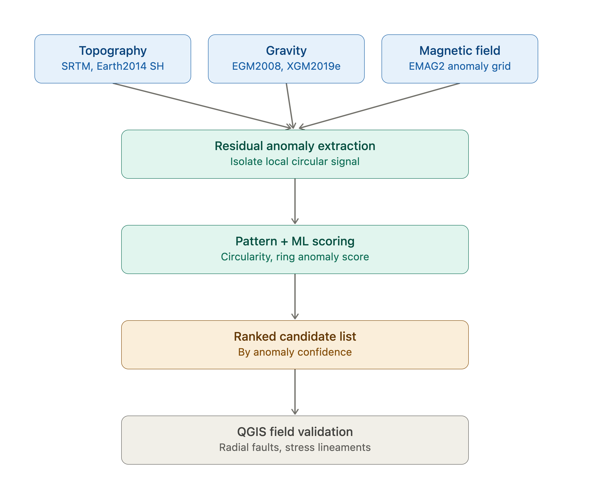
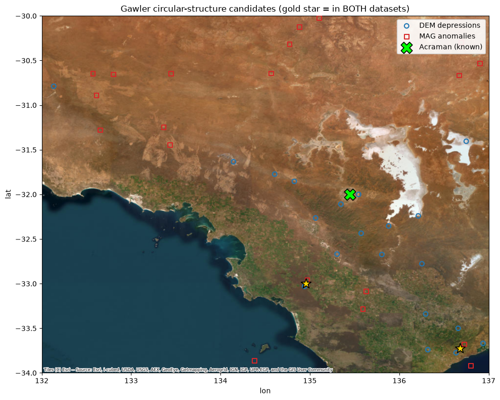
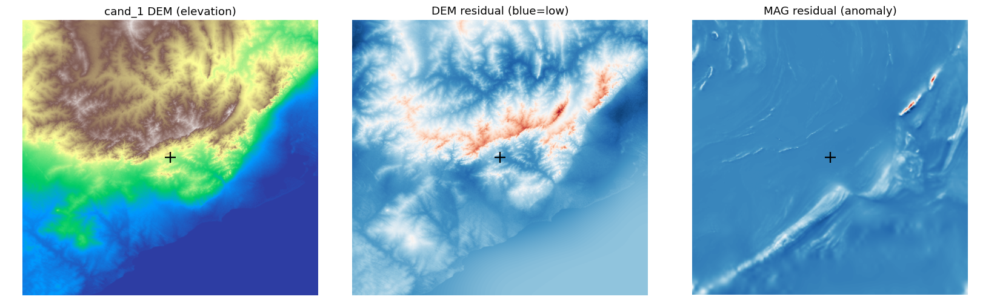
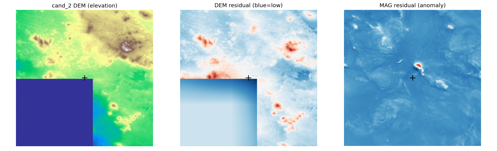

# Screening Earth: a geophysical crater-candidate pipeline for Australia

A multi-stage pipeline for searching for **undiscovered impact structures** in Australia using open geophysical data: satellite gravity and magnetic models, SRTM topography, and Geoscience Australia airborne magnetics.

Built for the *Impact Cratering and Shock Waves* course (MSc Earth & Planetary Sciences, University of Freiburg, 2026). The task was to find and defend a crater candidate good enough to justify a field trip.

> **Bottom line:** the pipeline works as a *triage tool*. It recovers the known 90 km Acraman structure, but none of the new candidates it produced survived geological scrutiny. That negative result is reported here as it is.



---

## Workflow

| Stage | Notebook / script | Data | What it does |
|---|---|---|---|
| 1 | `notebooks/01_prototype_synthetic.ipynb` | Synthetic field | Builds and validates the core detector (regional-trend removal → residual → radial-symmetry scoring) on a field with planted craters. |
| 2 | `notebooks/02_signature_characterization_synthetic.ipynb` | Synthetic | Asks whether gravity + magnetics can give a *sufficiently unique* crater signature, and whether it gets sharper for large craters. |
| 3 | `notebooks/03_real_gravity_magnetic_screening.ipynb` | XGM2019E gravity, NGDC-720 V3 magnetics | Extracts interpretable features at the 30 catalogued Australian impact structures and at random controls, then tests a Random Forest with cross-validated ROC-AUC and scans the continent. |
| 4 | `notebooks/04_detection_and_pu_ranking.ipynb` | XGM2019E (and a synthetic fallback) | Unsupervised detection plus a positive–unlabeled RF / XGBoost ranker. |
| 5 | `notebooks/05_gawler_dem_magnetic_scan.ipynb` + `scripts/circular_scan.py` | SRTM 1″ DEM, GA 40 m TMI grid | Tiled multi-scale radial matched filter over the Gawler Craton (DEM: central lows; magnetics: ring anomalies), validated on Acraman and then cross-matched between the two datasets. |
| 6 | `scripts/investigate_gawler.py`, `scripts/dem_crater_detect.py` | DEM + TMI tiles | Cuts DEM/magnetic tiles around each candidate for side-by-side checks and QGIS (hillshade, profiles, geology overlay). |

## Results

**Satellite potential fields cannot tell craters apart at this resolution.** On real data (stage 3), a Random Forest separating known craters from random locations scored:

| Subset | n craters | ROC-AUC (CV) |
|---|---|---|
| All craters | 30 | 0.43 ± 0.06 |
| D ≥ 20 km | 8 | 0.51 ± 0.26 |
| D ≥ 40 km | 3 | 0.55 ± 0.27 |

That is chance level. With a grid spacing of about 0.25° (roughly 28 km), structures smaller than a few tens of km cannot be resolved, so most Australian craters are below the resolution limit, and the few large ones are too few to learn from. The continent-wide scan gave candidate probabilities of only about 0.44–0.55. When checked against SRTM, every top cell turned out to be erosional terrain, linear ridges, flat plains or coastal/offshore artefacts.

The near-perfect AUC in stage 4 comes from **synthetic** data only. The real XGM2019E run returned 0 detections because the grid was too coarse, so that number should not be read as a real performance figure.

**High-resolution scan of the Gawler Craton** (lat −34° to −30°, lon 132° to 137°):

- **Validation:** the DEM scanner recovers **Acraman** at rank 14, **11 km** from its catalogued centre. The magnetic scanner does not find it in its top list.
- **Cross-match:** two locations were flagged by both DEM and magnetics:

| Candidate | Lat | Lon | Verdict |
|---|---|---|---|
| 1 | −33.727 | 136.681 | **Rejected.** Range-front erosional terrain with no circular rim in hillshade or profiles. |
| 2 | −32.996 | 134.956 | **Rejected.** A compact magnetic high offset from the depression on flat, near-coastal terrain. More consistent with an igneous intrusion or a data-boundary artefact. |



| Candidate 1 | Candidate 2 |
|---|---|
|  |  |

### Lessons

- Potential-field signatures are **non-unique**. Plutons, basins and greenstone belts can all look circular, so a matched-filter hit is a reason to look, not evidence.
- **Geological context** (maps, hillshade, profiles) did more of the actual decision-making than any classifier.
- Data resolution sets what is detectable. It is better to aim for structures the data can resolve than to add more layers.

## Setup

```bash
python -m venv .venv && source .venv/bin/activate
pip install -r requirements.txt
```

Notebooks 03 and 04 download XGM2019E and NGDC-720 through `pyshtools` on first run. This can take several minutes. Notebook 05 and the scripts need local rasters; see [`data/README.md`](data/README.md).

```bash
# scan a raster from the command line
python scripts/circular_scan.py data/raw/srtm_gawler_mosaic.tif --mode dem --region -34 -30 132 137
```

## Repository layout

```
notebooks/   analysis notebooks, in pipeline order (outputs kept)
scripts/     tiled raster scanner and candidate-inspection tools
data/        crater catalogue + instructions for downloading the rasters
figures/     figures used above
```

## Acknowledgements

Thanks to Prof. Anna Gülcher for feedback on non-uniqueness, gravity terminology and geological context. Data: ICGEM (XGM2019E), NOAA NCEI (NGDC-720), USGS (SRTM), and Geoscience Australia / Government of South Australia (AWAGS magnetic grids, CC BY 4.0).

## License

Code: MIT (see `LICENSE`). Third-party datasets keep their own licences.
